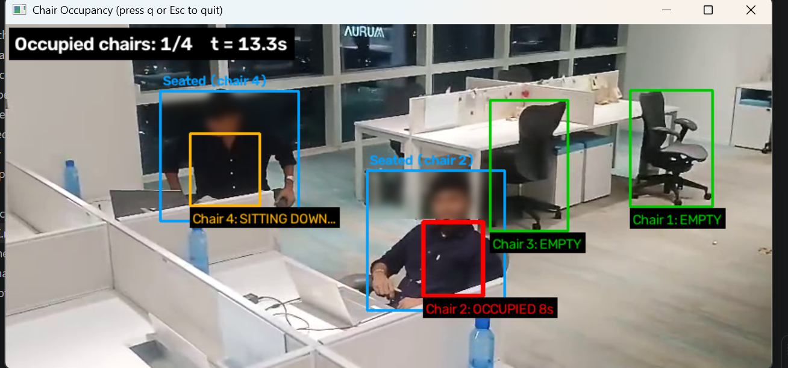

# Chair Occupancy Detection

Detects chairs and people in a video, decides which chairs have a **seated** person on them, and measures how long each chair is occupied. People and chairs are found with **YOLOv8**, **OpenCV** handles the video, and a small state machine turns noisy per-frame detections into stable *empty / sitting down / occupied* states with timers.

   

## Features

- **Automatic chair detection and tracking.** Chairs are detected with YOLO and tracked from frame to frame, so each chair keeps its id even if the camera moves a little or a chair is rolled around. A chair that is briefly hidden stays tracked, and a chair stays alive while someone sits on it.
- **Clean chair tracking.** YOLO sometimes reports one chair as two overlapping boxes. Nested and duplicate boxes are merged, so every real chair gets one id.
- **Sitting, not just standing nearby.** A chair counts only when a person who looks *seated* covers enough of it. A box that is tall and narrow (walking), or much taller than the chair (standing or leaning over a desk next to it), is ignored.
- **Occupied after a few seconds.** A chair turns *occupied* only after a seated person has stayed for `--occupy-after` seconds (default 2) and turns *empty* only after `--vacate-after` seconds without one. This removes flicker from missed detections.
- **Clear visual output.** Green box = empty, amber = someone is sitting down, red = occupied with a running timer. People are labelled *Seated (chair N)* or *Person*.
- **Reports.** Per-chair totals (`--report`) and every individual sitting with start, end and duration (`--sittings`).
- **Privacy mode.** `--anonymize` blurs people's heads in the output video.
- **Optional hand-marked chairs** for a fixed camera (`select_chairs.py`).

## How it works

1. **Detect.** One YOLOv8 pass (every Nth frame) finds people and chairs.
2. **Track chairs.** New detections are matched to existing chair tracks, which gives stable chair ids.
3. **Match people to chairs.** A person counts as seated on a chair only if their box is not tall and narrow (`--sit-ratio`), is not much taller than the chair (`--max-height-ratio`), and their lower body covers enough of the chair box (`--min-overlap`). Each person is assigned to the one chair they overlap most.
4. **Smooth and time.** A per-chair state machine applies the `--occupy-after` and `--vacate-after` delays and records each sitting.
5. **Report.** The annotated video, a console summary and optional CSV files are produced.

Times are measured in **video seconds** (frame number divided by frame rate), so results do not depend on how fast your computer processes the video.

## Camera angle

The posture check and the overlap rule are heuristics, so the camera view matters:

- Best results come from a camera placed **in front of or beside the chairs and slightly above them**, so people and chairs are both visible.
- A **top-down** view makes people look like wide, short boxes whether they sit or stand, so standing people may be counted as sitting. A **very low** angle may hide the chairs behind desks.
- Tune three settings for your view: `--sit-ratio` (box height / width above which a person counts as standing), `--max-height-ratio` (how many times taller than the chair a seated person's box may be) and `--min-overlap`. If standing or leaning people are counted as sitting, lower `--max-height-ratio` or raise `--min-overlap`. If seated people are missed, raise `--max-height-ratio` or `--sit-ratio`, or lower `--min-overlap`.
- If chairs are missed by the detector, try a larger model (`--model yolov8m.pt`) or lower `--chair-conf`. If the camera is fixed and detection is unreliable, mark the chairs by hand with `select_chairs.py`.

## Setup

```bash
python -m venv .venv
# Windows:        .venv\Scripts\activate
# macOS / Linux:  source .venv/bin/activate
pip install -r requirements.txt
```

YOLO weights download automatically the first time you run the detector. Installing `ultralytics` also installs PyTorch, which is a large download.

## Usage

```bash
python main.py --video my_video.mp4 --report report.csv --sittings sittings.csv --output annotated.mp4
```

Press `q` or `Esc` in the window to stop early. Use `--video 0` for a webcam and `--no-display` to run without a window.

For a fixed camera with hand-marked chairs:

```bash
python select_chairs.py --video my_video.mp4     # drag a box around each chair, press s to save
python main.py --video my_video.mp4 --chairs chairs.json
```

### Options

| Option | Default | Meaning |
| --- | --- | --- |
| `--video` | required | Video file, or `0` for the webcam |
| `--chairs` | none | `chairs.json` from `select_chairs.py`; leave out to detect chairs automatically |
| `--model` | `yolov8s.pt` | YOLO weights (`yolov8n.pt` is faster, `yolov8m.pt` is more accurate) |
| `--conf` | `0.4` | Minimum person confidence |
| `--chair-conf` | `0.25` | Minimum chair confidence |
| `--stride` | `3` | Run detection on every Nth frame (higher is faster) |
| `--min-overlap` | `0.25` | Share of the chair box a seated person must cover |
| `--sit-ratio` | `1.8` | A person box taller than this (height / width) counts as standing |
| `--max-height-ratio` | `2.2` | A person box more than this many times taller than the chair box is not seated on it |
| `--occupy-after` | `2.0` | Seconds of sitting before a chair counts as occupied |
| `--vacate-after` | `2.0` | Seconds without a seated person before a chair counts as empty |
| `--chair-max-age` | `3.0` | Seconds to keep a chair that is no longer detected |
| `--output` | none | Save the annotated video |
| `--report` | none | Per-chair totals as CSV |
| `--sittings` | none | Every sitting (start, end, duration) as CSV |
| `--anonymize` | off | Blur people's heads in the output |

The defaults are starting points and should be tuned for each camera view.

**Speed.** On a laptop CPU, detection can be slower than real time. Use `--stride 5` (detect less often), `--model yolov8n.pt` (smaller model), or `--no-display` with `--output` to process a video without drawing a live window.

## Output

Console summary:

```
Processed 14.7 seconds of video
  Chair 1: occupied 11.7s in 1 sitting(s)
  Chair 2: occupied 0.0s in 0 sitting(s)
```

`sittings.csv`:

```
chair,start_s,end_s,duration_s
1,3.0,14.7,11.7
```

## Project structure

```
main.py            video loop, YOLO detection, drawing and reports
occupancy.py       posture check, person-to-chair matching, state machine and timers
chairs.py          chair tracking across frames (and hand-marked chairs)
select_chairs.py   optional click-and-drag tool for marking chairs
tests/             unit tests and end-to-end tests with synthetic videos
```

## Tests

```bash
python -m unittest discover -s tests -v
```

The 40 tests cover the posture check, person-to-chair matching, duplicate chair boxes, the timers (including short detection gaps and brief walk-bys), chair tracking with a drifting camera, a regression case built from a real test frame, and the whole video loop. They use synthetic videos and a scripted fake detector, so they run without YOLO, a camera or any footage.

## Limitations

- **Heuristic, not learned.** Occupancy comes from box geometry and a posture guess, not from a model trained for sitting. It has not been evaluated on a labelled dataset, so no accuracy figure is claimed.
- **Detector dependent.** Chairs that YOLO cannot see (heavily hidden by partitions, unusual designs) are not tracked. A larger model or hand-marked chairs can help.
- **Camera angle matters** (see above). The size checks assume the whole chair is detected. If a chair is mostly hidden, its box is small and a seated person can look too tall for it, so raise `--max-height-ratio`.
- **Chairs only.** It detects people, so a bag on a chair does not count as occupied.
- **No demo footage is included.** Recordings of people should not be published without their consent. Use `--anonymize` for any shared output.
- **Known issue:** a person standing or leaning over a desk right next to a chair can briefly look like someone sitting down (the chair turns amber). A longer `--occupy-after` hides most of it. Pose estimation (hip and knee keypoints) is the planned next step.

## License note

This project uses [Ultralytics YOLOv8](https://github.com/ultralytics/ultralytics), which is licensed under AGPL-3.0. Check its license terms before distributing or deploying a derivative work.

## Author

Built by **Riya Patkar** ([@riyax11](https://github.com/riyax11)).
